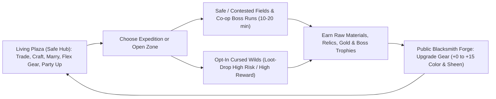
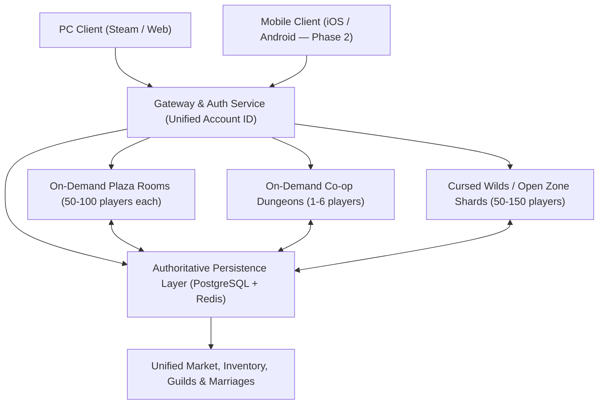

# Project VESSEL — Full MMORPG Project Blueprint
*Working Codename · Grounded Fantasy Social-Action Micro-MMO*

---

## 1. Executive Vision & Core Pitch

**One-Line Pitch:**
A stylized isometric fantasy online RPG where neutral, cloaked stone-carved vessels live, trade, marry, and show off color-evolving forged armor in a bustling sunlit plaza—before stepping out with friends into *Sword Art Online*-style monster wilds and opt-in high-stakes loot-drop dungeons.

**Core Pillars (The 5 Non-Negotiables):**
1. **Living Social Plaza ("The Digital Third Place"):** Town isn't a dead menu screen—it's a lively, 50–100 player hangout with market stalls, live blacksmith upgrade crowds, partner/marriage ceremonies, emotes, and proximity voice.
2. **Visible Status Through Forged Gear (*MU*-Inspired):** Every weapon and armor piece shows on the body and shifts metal color, shine, and subtle aura by upgrade level (`+0` to `+15`). High-tier prestige must be **earned, never bought**.
3. **Timeless *Wind Waker* Cel-Shading + Iconic Non-Human Vessels:** Compact, cloaked carved-relic vessels (not human, not goofy cartoon) in crisp 3D cel-shading—instantly recognizable in half a second, cheap to produce cosmetics for, and super readable on phones and streams.
4. **Zoned Risk (Cozy Town + High-Stakes Wilds):** Safe social zones protect casual and mobile players; opt-in high-stakes danger zones drop loot on death so items circulate, adrenaline stays real, and player accounts keep lasting economic value.
5. **Real Account Value + Seamless PC-to-Mobile Continuity:** One server-authoritative persistent database for accounts, inventories, and the unified market—launched PC-first to prove the loop, with mobile cross-progression built into the backend from Day 1.

---

## 2. Market Rationale (2025–2026 Research Grounding)

| Market Reality (2025–2026 Data) | How Project VESSEL Solves It |
| :--- | :--- |
| **80–90%+ of traditional indie MMOs fail** from scope creep, empty worlds, and 24/7 server burn. | **Hybrid Micro-MMO architecture:** Persistent account/economy DB + on-demand 50–100 player zone rooms instead of one costly empty open world. |
| **50%+ of Gen Z/Alpha use games daily as social hangouts**; **~78% of Gen Z buy in-game identity items**. | Dense **Living Plaza**, marriage/partner bonds, and deep cosmetics (masks, cloaks, pets, emotes) drive organic retention and clean monetization. |
| **TikTok & Twitch virality runs on 15-second emotional spikes** (chaos, tension, laughs, flexing). | Live **public blacksmith upgrade rolls**, 10–20 min co-op boss runs with proximity voice, and dramatic opt-in loot escapes. |
| **Cross-progression boosts D30 retention by +25–40% and ARPU by 2–3x**, but adds **+30–50% upfront dev cost**. | Build the **unified account backend Day 1**, prove fun on **PC first**, then ship **Mobile** right after traction so mobile becomes the daily trading/social habit. |
| **Players reject pay-to-win and FOMO daily chores** ("second-job" burnout). | Zero pay-to-win power, zero cash-shop upgrade protection, zero forced daily login punishments; **tradeable VIP token** (*OSRS Bond*/*Albion* model) lets free players earn everything. |

---

## 3. Art Direction, World Ambiance & Character Design

### Visual Style
- **Renderer:** True 3D cel-shading inspired by *The Legend of Zelda: The Wind Waker HD*—clean two-tone sunlight/shadow bands, warm painted textures on cloth, stone, and metal, soft/optional outlines (no muddy comic-book ink soup in crowded plazas).
- **Camera:** **Isometric (angled top-down)**, similar to *League of Legends* and *Albion Online*—fast to produce, clear spatial combat, effortless on weak PCs and 6-inch mobile screens.
- **Visual Hierarchy:** Ground and architecture use slightly softer, lower-saturation warm stone and meadow tones so brightly cel-shaded vessels, spell telegraphs, and glowing upgraded gear pop immediately.

### Character Identity — Compact Cloaked Carved Vessels
*Visual reference: [vessel-v2-compact-tiers.jpg](file:///Users/diogo.silva/OpenBot/Agents/agent-0f47a086-7b1c-416a-86ce-7cb8de846218/concepts/vessel-v2-compact-tiers.jpg)*

- **Silhouette:** Compact, iconic ~3.5-heads-tall proportions (*Vivi* / *Wind Waker* / *Journey* scale)—heroic and mysterious, neither tall realistic human nor goofy big-eyed chibi cartoon.
- **Anatomy:** Neutral, non-human carved stone/wood/porcelain relic mask-head with subtle runic markings and two luminous eye slits peering beneath layered medieval hoods or open helms. No human faces, mouths, or gender-locked body meshes.
- **Production Multiplier:** A **single neutral base skeleton** means every armor set, cloak, mask, weapon, and emote fits every player automatically—cutting character art production costs dramatically while maximizing cosmetic variety.

### World Ambiance & Enemies (*SAO*-Inspired Atmosphere — Grounded Earth World)
- **World Structure:** A grounded high-fantasy continent—**not** a floating tower or floor-clear gimmick.
  - **The Sunlit Plaza (Central Town):** Warm cobblestone courtyard, central crystal fountain, open-air blacksmith anvil square, player market stalls, wedding chapel/garden, and tavern bulletin board.
  - **Starter Meadows & Timberlands (Safe/Low-Risk):** Rolling green fields, stone ruin archways, sunlit forests, boars, wolves, bandits, and roving relic sentinels.
  - **Ancient Labyrinths & Cursed Wilds (High-Risk):** Dramatic palette shift into twilight storms, mist-choked marshes, and torchlit obsidian catacombs.
- **Enemies & Bosses:** Memorable, towering fantasy creatures with crisp, telegraphed weapon swings and readable ground danger zones (armored kobold captains, horned labyrinth lords, giant relic golems, shadow-antlered stalkers).

---

## 4. Core Gameplay Loop & Systems

### A. The Living Plaza (Social Hub)
- **Channel Cap:** 50–100 players per plaza channel (smart auto-fill so the town always feels bustling even with modest total concurrency).
- **Social Features:**
  - **Proximity voice chat** (opt-in/mute-friendly) + expressive radial emotes + quick chat bubbles (great on mobile).
  - **Public Blacksmith Square:** Players forge and upgrade gear in front of everyone; high-tier upgrade attempts trigger dramatic anvil sparks, chime audio, and nearby chat announcements—creating instant crowd hype.
  - **Player Market Stalls & Unified Auction Board:** Browse items cleanly on PC or mobile with preset price sliders and 1-tap relisting.
  - **Partner / Marriage System:** Two players can forge a **Vessel Bond** in a plaza ceremony (inviting friends/guildmates), unlocking matching subtle ring-halos, duo emotes, shared storage tab, and fast-travel-to-partner in safe zones.
  - **Timed World Events:** Wandering Rare Merchant, Plaza Lantern Festivals, and World Boss alerts (paired with official Discord webhook notifications so communities ping each other to log in).

### B. Combat & Progression
- **Classless Weapon Identity:** Your equipped weapon defines your active skills (e.g., Broadsword & Shield, Dual Blades, Greatsword, Spear, Staff/Wand, Bow)—easy to learn, huge build expression.
- **Tactical Action Feel:** 4 active weapon skills + 1 dodge/dash + basic combo. Emphasizes **clear telegraphs, timing, and positioning** over hyper-twitch pixel clicking so PC (mouse/keyboard) and mobile (MOBA virtual joystick + drag-to-aim skills) both feel natural.
- **No Auto-Play:** Zero auto-combat or auto-questing. Progress feels earned.

### C. *MU*-Inspired Visible Gear Progression (Example Tier Table)
*Design target — one armor model scales across 5 visual shader tiers without needing 5 separate 3D meshes:*

| Upgrade Tier | Visual Transformation on Body | Risk / Upgrade Rule (100% In-Game) |
| :--- | :--- | :--- |
| **`+0` to `+3`** | Matte dark iron / raw steel, worn cloth | 100% safe craft/upgrade using basic ores |
| **`+4` to `+6`** | Clean polished steel sheen, sharper specular edge | Low fail chance; failure consumes materials only |
| **`+7` to `+9`** | **Tempered Cobalt-Sapphire** metallic tint + crisp cool blade glints | Moderate risk; failure drops `-1` level (never deletes item) |
| **`+10` to `+12`** | **Emerald / Amethyst Arcane Gleam** + luminous runic inlays | High risk; requires boss catalyst gems; failure drops `-2` levels |
| **`+13` to `+15`** | **Burnished Crimson-Gold Filigree** + intense sunlit sheen + subtle floating embers | Prestige endgame; public plaza announcement on success |

- **Cosmetic Integration Rule:** Players can wear any cosmetic armor/cloak silhouette, and **their equipped gear's earned upgrade color/sheen/embers carry over onto the cosmetic** (toggleable on/off). Paid cosmetics can *never* fake a `+13` earned aura.

### D. Zoned Risk & Death Rules

| Zone Type | PvP Enabled? | What Drops on Death? | Target Player & Reward |
| :--- | :---: | :--- | :--- |
| **Green — Plaza & Starter Meadows** | — | Nothing | Social players, mobile sessions, crafters, new players |
| **Yellow — Contested Wilds & Co-op Dungeons** | Opt-in / Duels only | 30–50% of **unbanked run loot** (materials/drops only) | Casual-to-core squads (1–6 players); steady upgrade gems & boss gear |
| **Red — Cursed Wilds (Opt-In)** | ✓ (Full PvP) | **100% of backpack loot + replaceable combat gear** *(Cosmetics, masks, marriage items NEVER drop)* | High-stakes thrill-seekers & guilds; rare endgame catalysts, titles & huge market profits |

---

## 5. Player-Driven Economy & Ethical Monetization

### Keeping the Economy Healthy Forever
- **Unified Single-Shard Market:** PC and mobile share one central economy database.
- **Built-In Item Sinks:** Red-zone gear loss/salvage + blacksmith material consumption + cosmetic dye crafting continuously remove surplus items and gold, preventing runaway inflation.
- **Crafter ↔ Fighter Loop:** Peaceful/mobile players gather, refine, craft gear, and supply upgrade catalysts; frontline fighters buy gear sets to push Red Zones and sell rare boss relics back to crafters.
- **Anti-Exploit Guardrails:** Every trade, forge roll, drop, and market transaction runs inside **atomic database transactions** on the server with automated anomaly alerts for gold/item spikes.

### Monetization (Free-to-Play, Zero Pay-to-Win)
1. **Pure Cosmetics Store:** Unique carved mask designs, hoods, cloaks, dyes, non-combat pets, ceremony themes, stall skins, and emotes.
2. **Tradeable VIP Token (*OSRS Bond* / *Albion Gold* Model):**
   - Grants comfortable quality-of-life perks (extra auction slots, +15–20% crafting/gathering convenience, extra cosmetic preset slots—**zero combat stat bonuses, zero upgrade protection scrolls**).
   - Can be bought with cash and **sold legally on the in-game market for gold**—letting active free players earn VIP through gameplay while spenders fund server upkeep.
3. **Optional Founder's Pack (Early Access):** One-time supporter pack ($15–$25) with exclusive legacy mask/cloak + VIP tokens to fund early live ops.
4. **Direct Webstore Sync:** Account-linked webstore alongside Steam/iOS/Android to improve net margins (~15–22% lift vs. 30% mobile store fees) while respecting platform guidelines.

---

## 6. Technical Architecture & PC-to-Mobile Strategy

### System Architecture (Hybrid Persistence)

### Recommended Tech Stack

| Layer | Recommended Choice | Alternative | Why |
| :--- | :--- | :--- | :--- |
| **Game Client** | **Unity (C#)** *(single codebase, PC + Mobile UI profiles)* | **Godot 4** (zero royalty, super lightweight) or **WebGL/Three.js** (zero-install browser first) | Unity is battle-tested by *Albion Online* for single-codebase PC+Mobile cel-shaded MMOs; Godot is ideal if prioritizing zero licensing fees and lean builds. |
| **Game Server** | **Nakama (Go/TS, self-hosted)** or **Custom Go/Rust** | **SpacetimeDB** (fastest backend iteration) or **Colyseus** (if JS/TS stack) | Nakama includes accounts, chat, friends, guilds, and authoritative matches out-of-the-box; Go/Rust gives lowest compute cost per player. |
| **Persistence** | **PostgreSQL** (items, market, accounts) + **Redis** (sessions, room routing, rate limits) | Managed Postgres (Supabase/Neon) early on | Strict ACID transactions prevent item duplication exploits. |
| **Hosting** | **Hetzner / OVH / Vultr** bare-metal or VPS + Cloudflare | AWS/GCP *(avoid heavy egress traffic here)* | Avoids ~$0.09/GB hyperscaler bandwidth traps; keeps server bills around **$150–$600/month per 1,000 CCU**. |

### Cross-Progression & Session Asymmetry Plan
- **Day 1 Foundation:** Build a **custom unified Account ID** (linking Steam, Apple, Google, or email) + server-saved inventories from Week 1 so you never hit the cross-progression retrofit trap.
- **PC Experience (30–120 min sessions):** Full combat precision, high-tier dungeon bosses, Red-Zone runs, guild politics.
- **Mobile Experience (5–15 min sessions — Phase 2):** Collapsible edge-docked menus, big 1-tap market/crafting buttons, plaza socializing/weddings, blacksmith upgrades, and responsive MOBA-style virtual joystick + drag-to-aim casual runs. **Identical item icons and tier colors** across both devices build instant muscle memory.

---

## 7. Viral Growth & Community Engine (2026 Playbook)

1. **Instant Visual Identity:** Compact cel-shaded carved vessels + glowing forged metal stand out immediately on Steam grids, TikTok feeds, and YouTube thumbnails.
2. **Engineered Clip Moments:**
   - Public plaza blacksmith upgrades (`+11 → +12` crowd tension).
   - Proximity-voice co-op boss wipes & clutch revives.
   - Red-Zone last-second escapes carrying a rare golden boss relic.
3. **Discord Ecosystem From Day 1:** Built-in bot/webhooks announcing rare wandering merchants, world boss spawns, and server-first `+15` crafts.
4. **Creator-Friendly Playtests:** Open weekend "Plaza & Boss Stress Tests" with instant squad invite codes so streamers can drop in with viewers effortlessly.

---

## 8. Phased Production Roadmap & Vertical Slice (MVP)

### Phase 0 — Core Validation Prototype *(Weeks 1–6)*
*Goal: Prove the look, feel, and server persistence with the smallest possible playable slice.*
- **1 Isometric Plaza Room** (up to 50 vessels moving, chatting, emoting).
- **1 Combat Arena / Mini-Dungeon** (1–4 players co-op vs. 2 mob types + 1 *SAO*-style telegraphed mini-boss).
- **1 Authoritative Backend** (login, saved inventory, 1 weapon + 1 armor set).
- **Working *MU*-style Upgrade Shader** (`+0`, `+7` sapphire, `+13` crimson-gold) testable at a live plaza anvil.
- *Success Gate:* 10–20 testers actually want to log back in and hang out at the anvil/boss without being asked.

### Phase 1 — Closed Alpha ("The Core Loop") *(Months 2–5)*
- Full **Living Plaza** (market auction board, player stalls, Vessel Bond/marriage prototype, basic cosmetics shop).
- **3 Weapons** (Broadsword, Dual Blades, Staff/Spear) + **2 Open Zones** (Green Meadow + Yellow Ruin Dungeon) + **1 Opt-In Red Zone**.
- Economy logging, anti-duplication transaction tests, and Discord event webhook integration.

### Phase 2 — PC Early Access Launch (Steam + Optional Web Demo) *(Months 6–12)*
- Polished cel-shaded art pass, 6+ armor sets, 5+ bosses, 30+ cosmetic masks/cloaks, full marriage ceremonies, guild system.
- Launch Free-to-Play (or Supporter Pack Early Access) with Cosmetics + Tradeable VIP Token.
- Run creator playtests, balance economy sinks, and prove **30-day retention & positive LTV > server cost**.

### Phase 3 — Mobile Cross-Progression Launch (iOS & Android) *(Post-Traction)*
- Dedicated mobile UI profile (collapsible side tabs, 1-tap trading/forging, MOBA joystick + drag-to-aim).
- Low-spec Android optimization pass + Apple/Google store compliance + unified account linking.
- Global push into high-growth cross-platform markets (LATAM, Southeast Asia, NA/EU).

---

## 9. Top Risks & Mitigations

| Risk | Severity | Concrete Mitigation |
| :--- | :---: | :--- |
| **Item duplication / economy exploit** | Critical | Strict server-authoritative ACID DB transactions; zero client-trusted inventory changes; automated wealth-spike circuit breakers. |
| **Fixed server burn if population dips** | High | On-demand room scaling + low-egress VPS hosting (Hetzner/OVH); merge plaza channels dynamically so town never looks empty. |
| **Casual players quitting over loot loss** | High | Strict zoned risk (Green/Yellow/Red); cosmetics & marriage items **never** drop; Red Zone is strictly opt-in. |
| **Scope creep (trying to build 100 zones)** | Critical | Lock MVP to **1 Plaza + 2 Zones + 1 Boss Dungeon**; expand zones only after the core social + forge + combat loop proves sticky. |
| **Mobile UI & QA delaying launch** | High | Architect unified accounts Day 1, but launch **PC first**—ship Mobile in Phase 3 once revenue and retention are validated. |

---

## 10. Immediate Next Decisions to Start Building
1. **Team & Budget Reality:** Solo developer, small indie team (2–5), or funded studio?
2. **Engine Pick:** **Unity** (fastest PC+Mobile crossplay pipeline), **Godot 4** (open-source, lightweight), or **Web-First (TypeScript/Three.js)** (zero-install instant browser virality)?
3. **First Prototype Milestone:** Do you want to spin up the **Phase 0 vertical slice** next (playable isometric plaza + cel-shaded vessel + live `+0/+7/+13` upgrade shader + multiplayer server)?
